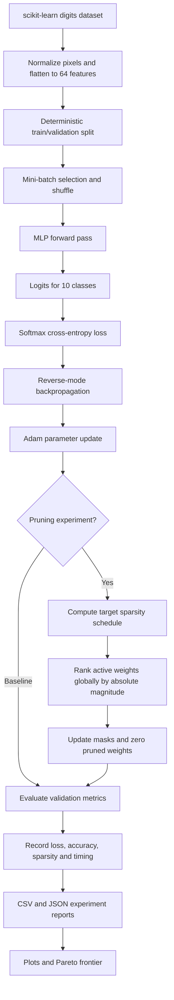

# Self-Pruning Network

A small neural-network library built from scratch with Python and NumPy. It implements a custom reverse-mode automatic differentiation engine, a multilayer perceptron (MLP), Adam optimization, gradual global magnitude pruning, and tools to analyze accuracy-versus-sparsity trade-offs.

The project is designed as an end-to-end machine-learning engineering study: **train a baseline model, gradually remove low-magnitude weight connections, measure the accuracy cost, and then determine whether the resulting sparsity provides practical inference or storage benefits.**


---

## Table of contents

- [Project goals](#project-goals)
- [End-to-end architecture](#end-to-end-architecture)
- [Model architecture and tensor shapes](#model-architecture-and-tensor-shapes)
- [What happens in a training step](#what-happens-in-a-training-step)
- [Automatic differentiation](#automatic-differentiation)
- [Loss and evaluation](#loss-and-evaluation)
- [Adam optimizer](#adam-optimizer)
- [Pruning design](#pruning-design)
- [Experiments and current observations](#experiments-and-current-observations)
- [Analysis and Pareto frontier](#analysis-and-pareto-frontier)
- [Repository layout](#repository-layout)
- [Environment setup](#environment-setup)
- [How to run the project](#how-to-run-the-project)
- [Tests](#tests)
- [Outputs and generated files](#outputs-and-generated-files)
- [Current limitations and next milestones](#current-limitations-and-next-milestones)
- [Design decisions and trade-offs](#design-decisions-and-trade-offs)

## Project goals

The implementation explores these questions:

1. How can reverse-mode automatic differentiation be implemented without relying on a deep-learning framework?
2. How do a forward pass, a loss function, backpropagation, and an optimizer work together to train an MLP?
3. What happens to validation accuracy when small-magnitude weights are progressively removed?
4. Does global magnitude pruning distribute removed connections differently from pruning each layer independently?
5. How should an experiment distinguish a model with many zero weights from a genuinely efficient sparse model?

### Engineering scope

- **Core numerical stack:** NumPy for training/autodiff; SciPy CSR for sparse inference
- **Dataset loading:** scikit-learn only; the model, autodiff, optimizer, loss, and pruning logic are implemented in this repository
- **Model:** fully connected MLP for 10-class digit classification
- **Training:** mini-batch training with Adam
- **Pruning:** global, weight-magnitude-based pruning with a cubic target-sparsity schedule
- **Experiment analysis:** CSV/JSON summaries, plots, and a Pareto-frontier calculation
- **Sparse deployment:** CSR inference, equivalence tests, and a benchmark script are implemented; measured results must be generated on the target machine

## End-to-end architecture

The system has two related paths: the **training path**, which calculates gradients and updates weights, and the **pruning/analysis path**, which progressively masks low-importance connections and compares experiment outcomes.



### End-to-end execution in plain language

1. Load the handwritten-digit examples and convert each image to a 64-number feature vector.
2. Use the first dense layer to turn 64 input features into 128 learned activations.
3. Use a second dense layer to transform 128 activations into 64 more abstract activations.
4. Use the final dense layer to produce 10 class scores, one per digit.
5. Compare the scores with the correct digit label using cross-entropy loss.
6. Backpropagate the loss to calculate gradients for the model parameters.
7. Update weights with Adam.
8. In a pruning run, calculate a target sparsity for the current training step, rank currently active weights by absolute magnitude, and mask the lowest-scoring weights.
9. Evaluate the model against the validation split and record its metrics.
10. Analyze the results to compare accuracy against the number of remaining active weights.

## Model architecture and tensor shapes

The MLP uses the architecture:

`64 → 128 → 64 → 10`

For a mini-batch containing `B` images:

| Component | Weight shape | Bias shape | Output shape | Role |
|---|---:|---:|---:|---|
| Input | — | — | `(B, 64)` | Flattened, normalized 8×8 pixels |
| Dense layer 1 | `(64, 128)` | `(128,)` | `(B, 128)` | Learn features from the pixels |
| ReLU 1 | — | — | `(B, 128)` | Introduce nonlinearity |
| Dense layer 2 | `(128, 64)` | `(64,)` | `(B, 64)` | Learn a second feature representation |
| ReLU 2 | — | — | `(B, 64)` | Introduce nonlinearity |
| Dense layer 3 | `(64, 10)` | `(10,)` | `(B, 10)` | Produce one logit per digit class |

Each dense layer calculates:

```text
output = input @ weight + bias
```

The first two layer outputs pass through ReLU:

```text
ReLU(x) = max(0, x)
```

The last layer returns **logits**, not normalized probabilities. The cross-entropy loss performs a numerically stable softmax/log-softmax calculation internally for training.

### Parameter count

The model contains the following weight connections:

- Layer 1: `64 × 128 = 8,192` weights
- Layer 2: `128 × 64 = 8,192` weights
- Layer 3: `64 × 10 = 640` weights
- **Total weights: 17,024**

The bias vectors contain `128 + 64 + 10 = 202` parameters.

- **Total trainable parameters: 17,024 + 202 = 17,226**

Pruning only applies to the weight matrices. Biases are not included in the prunable-weight count and are not masked.

### Weight initialization

Each dense layer uses a seeded NumPy random generator and samples weights from a normal distribution scaled by:

```text
scale = sqrt(2 / number_of_input_features)
weight = standard_normal(shape) × scale
```

The biases start at zero. Each layer receives a reproducible seed derived from the model seed.

The scale helps keep activation magnitudes in a useful range at initialization. It is a He-style variance scaling choice commonly associated with ReLU networks; initialization quality is still a design decision to validate if the architecture changes.

## What happens in a training step

The training code follows this sequence for every mini-batch:

1. **Shuffle:** create a reproducible random permutation of the training indices for the epoch.
2. **Select a mini-batch:** use up to 64 examples for the current batch.
3. **Clear gradients:** call `optimizer.zero_grad()` to avoid accidentally accumulating gradient values from a previous batch.
4. **Forward pass:** run the batch through the three dense layers and the two ReLU activations.
5. **Calculate loss:** compute mean softmax cross-entropy against the true class labels.
6. **Backward pass:** call `loss.backward()` to traverse the recorded computation graph in reverse topological order and accumulate parameter gradients.
7. **Update:** call `optimizer.step()` to apply Adam's update.
8. **Prune if this is a pruning run:** compute the scheduled target sparsity and update the global masks after the optimizer step.
9. **Validate:** at the end of the epoch, evaluate loss and accuracy on validation data that is not used for the gradient updates.
10. **Record:** store per-epoch metrics and, for baseline training, save the best-validation and final-epoch model weights.

The baseline script retains its original fixed seed. The pruning runner supports one or multiple configurable seeds. Reproducibility does not mean results are guaranteed to be identical across all hardware, numerical-library builds, or future code changes.

## Automatic differentiation

The custom `Tensor` class stores:

- `data`: a NumPy array converted to float64
- `grad`: an array of accumulated derivatives, initially zero
- `_prev`: the parent tensors used to calculate this tensor
- `_backward`: a function that propagates this tensor's gradient to its parents

Tensor operations create a new tensor and attach a backward function. The implementation includes addition, subtraction, multiplication, division, matrix multiplication, sum, mean, ReLU, tanh, and sigmoid.

When `backward()` is called on a scalar loss, the engine builds a topological ordering of the computation graph and processes it in reverse. Each local backward function applies the chain rule and adds contributions to its parents' gradients. Broadcasted gradients are reduced to the original operand shape by a helper.

For a dense layer `Z = X @ W + b`, the corresponding matrix derivatives are conceptually:

```text
dL/dW = X.T @ dL/dZ
dL/db = sum(dL/dZ over the batch)
dL/dX = dL/dZ @ W.T
```

These derivatives allow the optimizer to adjust each trainable parameter in the direction that reduces the loss. The loss function supplies a custom backward function for the logits; it uses the familiar softmax-cross-entropy gradient `(probabilities - one_hot_targets) / batch_size`.

This is a learning-oriented implementation of reverse-mode autodiff, not a replacement for a production autodiff framework. New tensor operations should be accompanied by gradient tests, especially for broadcasting and matrix shapes.

## Loss and evaluation

### Softmax cross-entropy

For each input example, the model produces 10 logits. Softmax converts them into class probabilities:

```text
p(class=i) = exp(logit_i) / sum_j exp(logit_j)
```

Cross-entropy penalizes a low predicted probability for the correct class. The implementation subtracts the maximum logit before exponentiation, improving numerical stability and reducing the risk of overflow.

The batch loss is the mean cross-entropy over the examples. The target labels must be integer class indices from 0 through 9.

### Accuracy

Accuracy is the fraction of predictions matching the true labels. The predicted class is the index of the largest logit; a separate softmax calculation is unnecessary for choosing the maximum-scoring class.

The baseline evaluation also records a confusion matrix and per-class accuracy. This can reveal whether overall accuracy hides weaker performance on a subset of digits.

### Dataset and split

The loader uses scikit-learn's `load_digits` dataset:

- 1,797 labelled grayscale images
- Each image is 8×8 pixels
- Original pixel values range from 0 to 16
- Pixels are flattened into 64 features and divided by 16, giving values from 0 to 1
- Labels are the 10 digit classes, 0–9

The legacy load_smoke_dataset helper retains a deterministic 80/20 train/validation split for quick baseline runs. The pruning runner uses the newer load_dataset_splits loader, which creates stratified train/validation/test splits (80/10/10 by default), with the test set reserved for evaluating the validation-selected checkpoint. The pruning runner supports the digits dataset and a Fashion-MNIST loader fetched from OpenML. Fashion-MNIST requires network access on the first load.

The digits dataset is useful for fast development and implementation checks; even with a held-out test split, it is not evidence of production generalization.

## Adam optimizer

The custom `Adam` optimizer maintains first- and second-moment estimates of the gradients:

- `m`: exponentially weighted mean of gradients
- `v`: exponentially weighted mean of squared gradients
- `t`: optimizer update counter used for bias correction

After computing the bias-corrected moments, Adam adjusts each parameter using the learning rate and a small numerical-stability constant. The configured baseline settings are:

| Setting | Value |
|---|---:|
| Learning rate | 0.001 |
| `beta1` | 0.9 |
| `beta2` | 0.999 |
| `eps` | 1e-8 |
| Batch size | 64 |
| Training epochs | 30 |
| Random seed | 42 |

When a parameter has a pruning mask, the optimizer multiplies its gradients and moment estimates by that mask and re-applies the mask after the update. This prevents a masked weight from becoming nonzero again because of an update or stale momentum.

The optimizer still stores dense arrays for parameters and moment state. The mask-aware update therefore preserves pruning semantics, but does not itself create a compact sparse optimizer or sparse model representation.

## Pruning design

### What sparsity means here

A binary mask has the same shape as the layer's weight matrix:

- `1`: the connection remains active
- `0`: the connection is pruned

The effective weight is conceptually:

```text
effective_weight = weight × mask
```

The layer's forward pass currently performs dense matrix multiplication with that effective dense-shaped matrix. A pruned connection is functionally zero, but dense compute kernels may still perform operations over the full matrix shape.

### Global magnitude scoring

The sweep uses absolute weight magnitude as its importance score:

```text
importance(weight) = abs(weight)
```

The global algorithm gathers scores for currently active weights across all three layers, then keeps the highest-scoring active weights up to the desired global active-weight count. Low-magnitude connections are masked first.

Global pruning lets the layers retain different numbers of connections, according to the weights' relative scores across the whole network. This contrasts with layer-wise pruning, which would impose a target separately on each layer.

The pruning module also contains a Taylor-style helper:

```text
importance(weight) = abs(weight × gradient)
```

That helper is available for future exploration; **the current pruning sweep uses magnitude scores**, not Taylor scores.

### Cubic sparsity schedule

Pruning is gradual rather than applied all at once. The configured pruning experiment has a 5-epoch warm-up and reaches its target by epoch 30. The schedule is evaluated by optimizer step (mini-batch update), with warm-up and final steps derived from the number of batches per epoch.

Between warm-up and the final step, the target follows a cubic schedule:

```text
progress = (step - warmup_step) / (final_step - warmup_step)
target_now = target_sparsity × (1 - (1 - progress)^3)
```

Before or at warm-up the scheduled target is zero; at or after the final step the target equals the configured final sparsity.

Why gradual pruning? It gives the model time to learn useful representations before progressively removing connections, rather than abruptly zeroing many weights at the start. It is a design choice, not a guarantee that gradual pruning always performs better; that would require a controlled comparison.

### Mask update lifecycle

On each pruning training step:

1. Adam updates the current model parameters.
2. The cubic schedule calculates the current target sparsity.
3. Absolute magnitudes are calculated for active weights.
4. The global pruning function determines which active weights to keep.
5. The new binary masks are applied to the layer.
6. The layer multiplies its weight data by the new mask so pruned weights become exactly zero.
7. The optimizer respects the mask during subsequent updates.

The global and layer-wise pruning implementations never revive already-pruned connections within a run. Biases are not pruned.

### Sparse-aware inference

The MLP now exposes predict_logits_dense and predict_logits_sparse. The sparse path converts each masked weight matrix to SciPy CSR once, then performs sparse-weight/dense-activation multiplication at inference time. The returned CSR matrices are snapshots: rebuild them after training or changing a mask. The benchmark reuses the same input batch, checks numeric logits and exact class predictions before timing, warms both paths, reports median and p90 latency, and keeps CSR conversion time separate from inference. Results are hardware- and batch-size-dependent; CSR is not assumed to be faster for this small MLP.

A CI smoke benchmark was run on a GitHub-hosted Ubuntu runner using a 3-epoch digits run, 2 warm-up calls, and 10 timed repeats. These small-repeat measurements validate the pipeline only; they are not a deployment benchmark.

| Target sparsity | Batch size | Dense median | CSR median | Dense/CSR ratio |
|---:|---:|---:|---:|---:|
| 0% | 1 | 0.0115 ms | 0.0681 ms | 0.168× |
| 0% | 64 | 0.0592 ms | 0.2735 ms | 0.217× |
| 50% | 1 | 0.0110 ms | 0.0593 ms | 0.185× |
| 50% | 64 | 0.0736 ms | 0.1761 ms | 0.418× |

A ratio below 1× means CSR was slower in this smoke run. This is expected to depend on matrix size, batch size, SciPy/BLAS builds, and hardware. It shows why sparsity or estimated storage reduction alone must not be presented as an inference speedup. The CI workflow uploads the full CSV/JSON smoke report as the artifact named sparse-inference-smoke-results.

## Experiments and current observations

The default config evaluates five target sparsities under the same model seed and data split:

| Target sparsity | Meaning |
|---:|---|
| 0% | Dense baseline control; no pruning |
| 30% | Remove approximately 30% of weight connections |
| 50% | Remove approximately half of the weight connections |
| 70% | Primary accuracy/sparsity candidate |
| 90% | Aggressive-compression candidate |

Shared settings: seed 42, 30 epochs, batch size 64, learning rate 0.001, Adam optimizer, 5-epoch warm-up, and the cubic schedule. Each target is trained as an independent run initialized from the same deterministic starting configuration.

### Results from the recorded local sweep

The following values are historical results from the original local 80/20 smoke-split run, before the new 80/10/10 held-out-test runner. They are useful as a reference but are not results from the updated multi-seed runner or the sparse benchmark. Rerun the experiment to regenerate metrics with the current implementation.

| Target sparsity | Best validation accuracy | Final validation accuracy | Active weights | Total weights |
|---:|---:|---:|---:|---:|
| 0% | 98.33% | 97.49% | 17,024 | 17,024 |
| 30% | 98.33% | 97.49% | 11,917 | 17,024 |
| 50% | 98.05% | 97.49% | 8,512 | 17,024 |
| 70% | 98.33% | 98.33% | 5,107 | 17,024 |
| 90% | 97.77% | 97.21% | 1,702 | 17,024 |

Interpretation:

- **70% sparsity** retained the highest observed best validation accuracy (98.33%) while retaining 5,107 of 17,024 weight connections.
- **90% sparsity** retained 1,702 weight connections and had a best validation accuracy of 97.77%.
- The total parameter allocation remains 17,226 in the dense model representation. The pruning result reports nonzero weight connections, not a smaller dense tensor shape.
- The table shows the best validation accuracy observed across epochs separately from final-epoch accuracy. The current pruning script reports the best epoch from its history, but does not save a separate best pruned checkpoint for each target.
- These figures are from one small dataset split and one seed. Multiple seeds, a held-out test set, or a larger dataset would be needed to assess stability and generalization more thoroughly.

## Analysis and Pareto frontier

Run `src/analyze_pruning_results.py` after the pruning sweep. The script reads `results/raw/pruning_sweep.csv`, calculates the nondominated experiments when maximizing best validation accuracy and minimizing active weights, and writes:

- `results/figures/accuracy_vs_sparsity.png` — best and final validation accuracy by achieved sparsity
- `results/figures/active_weights_by_sparsity.png` — remaining nonzero weight count
- `results/figures/pareto_frontier.png` — validation accuracy versus active weight connections
- `results/raw/pruning_pareto_frontier.csv` — the experiments on the computed Pareto frontier

A result is dominated if another result has at least as high validation accuracy with no more active weights and at least one strict improvement. The recorded run's Pareto frontier contained the 70% and 90% candidates: the 70% result offered higher accuracy, while the 90% result retained fewer active weights.

A Pareto frontier identifies trade-offs among the measured objectives; it does not decide the best business choice automatically.

## Repository layout

```text
.
├── README.md
├── config.json
├── pyproject.toml
├── uv.lock
├── .python-version
├── src/
│   ├── aqua_nn/
│   │   ├── __init__.py
│   │   ├── autodiff/
│   │   │   ├── __init__.py
│   │   │   └── tensor.py              # Tensor operations and reverse-mode autodiff
│   │   ├── data/
│   │   │   ├── __init__.py
│   │   │   └── dataset.py             # Digit loading, normalization, split
│   │   ├── layers.py                  # Dense layer, weight masks, ReLU wrapper
│   │   ├── losses.py                  # Softmax cross-entropy and accuracy
│   │   ├── models.py                  # Configurable-input MLP; default 64 -> 128 -> 64 -> 10
│   │   ├── checkpoint.py              # Save/load weights, biases and pruning masks
│   │   ├── optim.py                   # Adam and mask-aware updates
│   │   └── pruning.py                 # Scores, cubic schedule, global pruning
│   ├── train_baseline.py              # Baseline training and metrics
│   ├── run_pruning_experiment.py       # Configurable pruning sweep + held-out test
│   ├── benchmark_sparse_inference.py   # Dense-vs-CSR latency/storage/memory benchmark
│   └── analyze_pruning_results.py     # Plots and Pareto-frontier CSV
└── tests/
    ├── test_dataset.py
    ├── test_masking.py
    ├── test_model.py
    ├── test_checkpoint.py
    ├── test_dataset_splits.py
    ├── test_layerwise_pruning.py
    ├── test_pruning_runner.py
    ├── test_sparse_benchmark.py
    ├── test_sparse_inference.py
    ├── test_pruning.py
    ├── test_tensor.py
    ├── test_tensor_milestone3.py
    └── test_training_components.py
```

## Environment setup

The project requires Python 3.12 or newer and uses `uv` for environment and dependency management. Direct dependencies are NumPy, scikit-learn, SciPy, and Matplotlib; Pytest is used for development tests.

From the repository root:

```powershell
uv sync
```

Check the Python version used by `uv`:

```powershell
uv run python --version
```

## How to run the project

Run all commands below from the repository root, `self-pruning-network/`.

### 1. Run the automated tests

```powershell
uv run pytest -q
```

The last recorded local run during development reported 31 passing tests. Run the suite again after pulling new changes to confirm the current environment.

### 2. Train the dense baseline

```powershell
uv run python src/train_baseline.py
```

The script trains for 30 epochs and writes baseline artifacts under `results/raw/`, relative to the current working directory:

- `baseline_history.csv`
- `baseline_metrics.json`
- `baseline_model_best.npz`
- `baseline_model_final.npz`

The baseline metrics include best and final validation results, training settings, elapsed time, parameter count, confusion matrix, and per-class accuracy. Check the final terminal output for the exact destination path.

### 3. Run the pruning sweep

```powershell
uv run python src/run_pruning_experiment.py
```

The default config runs target sparsities 0%, 30%, 50%, 70%, and 90%. Results for each configuration are preserved under results/raw/experiments/<run-label>/, including per-seed CSV, summary CSV, and JSON history. Root-level pruning_sweep.csv/json files are convenient aliases for the most recent run. Validation-selected, target-sparsity checkpoints are saved under results/raw/checkpoints/.

### Configurable pruning experiments

The root config.json selects the dataset, seeds, epoch count, batch size, learning rate, target sparsities, pruning method, scope, importance function, schedule, warm-up, and one-shot prune epoch. Command-line arguments override these values.

    uv run python src/run_pruning_experiment.py --seeds 42,43,44
    uv run python src/run_pruning_experiment.py --method one_shot --prune-at-epoch 10
    uv run python src/run_pruning_experiment.py --scope layerwise --importance taylor
    uv run python src/run_pruning_experiment.py --dataset fashion-mnist --epochs 10 --batch-size 128 --seeds 42,43 --target-sparsities 0,0.7,0.9

The last command downloads/caches Fashion-MNIST on first use and can take considerably longer than the digits smoke test. The test set is evaluated only after validation has selected a checkpoint.

### Dense-versus-CSR inference benchmark

After the pruning runner has saved checkpoints:

    uv run python src/benchmark_sparse_inference.py --batch-sizes 1,64,256 --warmup 10 --repeats 100

To benchmark a specific checkpoint, add --checkpoint followed by its path. The script writes CSV and JSON results under results/raw/. It checks dense/CSR logits and predictions before timing. Compare results on the target deployment machine; do not claim speedup unless the measurements demonstrate it.

### 4. Generate plots and Pareto analysis

```powershell
uv run python src/analyze_pruning_results.py
```

This reads the pruning CSV from the repository-root `results/raw/` folder and writes the three PNG plots plus `pruning_pareto_frontier.csv`.

### Important path note

The training and pruning scripts use a relative `Path("results/raw")`, so their output location depends on the current working directory. The recommended commands above run from the repository root. The analyzer resolves the repository root based on its own file location and expects the pruning CSV at that root's `results/raw/` path.

Generated root-level experiment outputs and images are ignored by Git so that local experiments do not automatically add plots, sweep results, or model checkpoints to source-control commits. The repository also contains earlier baseline summary artifacts under `src/results/raw/`.

## Tests

The test suite covers core tensor behavior, model components, training components, masking, pruning behavior, and the dataset loader. Run:

```powershell
uv run pytest -q
```

When extending the library, add tests for the behavior being introduced. In particular, sparse-aware inference should be tested against the existing dense masked path using both numerical logit tolerance and exact predicted-class equivalence.

## Outputs and generated files

CSV and JSON outputs are intended to make experiments inspectable without loading model objects. The baseline script writes best and final model weights and biases to NumPy `.npz` archives. The pruning runner saves a validation-selected checkpoint for each named configuration/seed/target under results/raw/checkpoints/. A checkpoint is eligible for selection only after its requested sparsity has been reached; the test set is then evaluated on that checkpoint. Named experiment summaries are preserved under results/raw/experiments/<run-label>/.

Model checkpoints and generated plots are excluded from the standard source-control flow. They can be recreated by running the scripts; if a particular artifact needs to be shared, a release asset or dedicated artifact store is usually more suitable than committing generated binaries to the source tree.

## Implementation status and remaining validation

### Implemented in this branch

- CSR sparse inference for the three dense layers, retaining dense activations between layers
- Equivalence tests comparing CSR logits (within floating-point tolerance) and exact predicted classes against dense masked inference
- A benchmark script reporting dense/CSR median and p90 latency, conversion time, dense and CSR storage (including sparse indices), traced peak allocations, and process RSS delta where supported
- Saved masked checkpoints for each seed/target combination
- Configurable one-shot versus gradual pruning, global versus layer-wise scope, and magnitude versus Taylor importance scores
- Repeated-seed runs (with a separate fixed split_seed) and stratified train/validation/test splits, with checkpoint selection based on validation only and test evaluation performed afterward
- A Fashion-MNIST OpenML loader for larger-dataset experiments

### Still requires an actual run on your machine

- Run the experiment suite on your own configured Python environment as a final environment-specific check; CI is configured for Python 3.12 on Linux and Windows
- Generate sparse latency and memory measurements on your target CPU; RSS deltas can be noisy, and the benchmark reports this limitation
- Run several seeds (for example, 42, 43, 44) and inspect mean and standard deviation rather than relying on one seed
- Execute the Fashion-MNIST experiment and record its results; the loader and runner support it, but no Fashion-MNIST accuracy or performance result is claimed here
- Consider isolated-process memory profiling and deployment-specific benchmarking before claiming a production speedup

### Performance reporting principles

The project distinguishes four different quantities:

1. **Target sparsity:** the intended proportion of weights to remove.
2. **Achieved sparsity:** the observed fraction of masked/zero weight connections.
3. **Weight-storage bytes:** representation-specific storage for weights (and, for sparse formats, their index arrays).
4. **Measured inference latency and runtime memory:** empirical performance measurements under a stated environment and benchmark protocol.

They are related but not interchangeable. CSR stores indices as well as values; it may save weight storage at high sparsity but can be slower on small matrices due to sparse-operation overhead. Masked dense arrays still occupy dense-shaped parameter storage and can continue using dense matrix multiplication.

## Design decisions and trade-offs

| Decision | Why it is used here | Trade-off / limitation |
|---|---|---|
| NumPy-based custom autodiff | Makes the forward and backward mechanics inspectable | Less optimized and less comprehensive than mature DL frameworks |
| Small MLP | Fast to train, test, and debug end-to-end | Does not represent the scale or structure of many production models |
| 8×8 digits dataset | Lightweight, deterministic development data | Results do not establish generalization to larger or more difficult datasets |
| Adam | Adaptive gradient updates with a compact implementation | Adds moment arrays and hyperparameters; it is not the only suitable optimizer |
| Global magnitude pruning | Simple, reproducible importance score and global ranking | Weight magnitude is only a proxy for connection importance |
| Cubic gradual schedule | Increases sparsity progressively during training | Schedule choices can affect convergence and should be compared empirically |
| Binary masks on dense arrays | Simple way to enforce permanently removed connections | Does not automatically accelerate inference or reduce allocated dense parameter storage |
| Best-epoch validation reporting | Shows the best observed validation accuracy across training | Repeated tuning against the same validation set can overfit model-selection decisions |

## License and usage

No license has been declared in the repository yet. Until a license is added, do not assume that the code is offered under an open-source license with standard reuse permissions.
